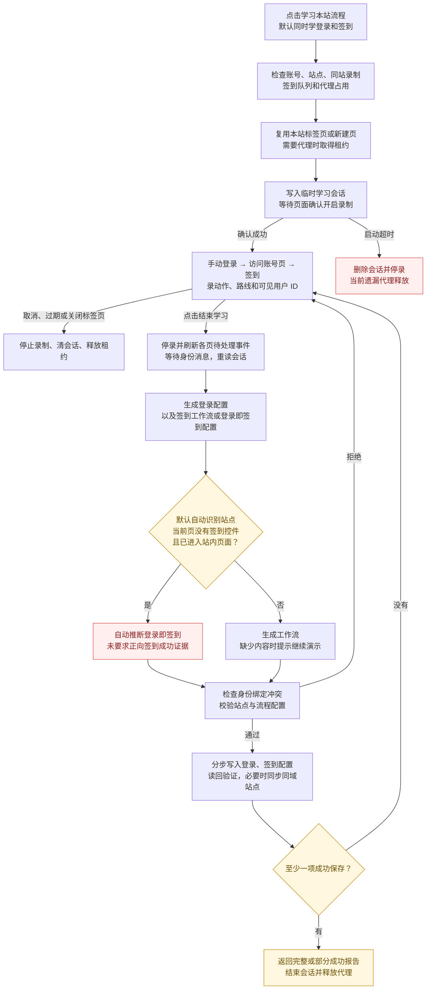
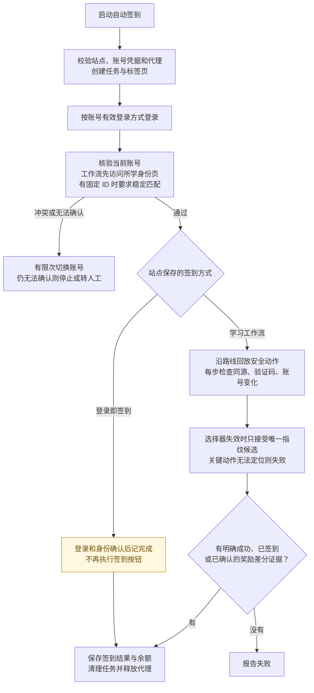

# 学习签到逻辑审核

审核日期：2026-11-23。范围为当前 `src/` 中的学习后台、内容录制器、管理界面以及签到回放链路。业务源码未作修改。

> 这是修改前的审核记录。后续已按“同站点共用、不同站点独立”的要求完成模块调整，
> 并处理了本文的自动登录即签到推断、启动失败代理清理、GitHub 模式丢失和来源缓存问题。
> 新的流程归属及首次账号身份确认机制见
> [站点共用签到流程说明](site-workflow-design.md)。

## 结论

主干设计合理：登录配置与签到工作流分开保存，身份绑定属于账号，工作流属于站点；学习和签到共享代理互斥；结束前等待事件写入；回放前核验稳定身份，回放中检查同源、验证码和账号变化，动作执行完不直接等于签到成功。

当前实现仍有 2 项 P1 和 5 项 P2。最严重的是用“当前页面没有签到按钮”自动推断“整个站点登录即签到”，以及录制握手失败后的代理资源泄漏。其余缺口涉及身份一致性、登录方式维护和故障恢复。

“学习完成”在当前实现里代表产物生成并写入配置，并不代表该产物已通过一次真实自动回放。

## 当前学习流程

主界面的“学习本站流程”发送 `kind=both`，同一个按钮在已有会话时执行结束保存。

录制会话有 30 分钟、100 条事件上限。输入保存字段角色、选择器和是否有值，不保存输入框 `.value`；验证码等字段不进入普通填充步骤。顶层页面每 650 毫秒采样可见数字用户 ID，连续稳定两次后发送后台。

仅登录学习是另一个模式；默认界面使用的是登录与签到学习。验证码可能需要人工完成，学习不会保存验证码值。

## 当前回放流程

默认自动识别、本站专用适配与学习工作流是不同执行方式。只有站点明确保存为工作流且未禁用回放，旧学习步骤才会执行。

## 确认的问题

### 1. P1：当前页无按钮被当成整个站点登录即签到

触发：原站点签到方式未设或为 `auto`；演示完成登录，停在 `/profile`、`/dashboard` 等没有签到按钮的页面，尚未访问真正的签到页，就点击结束学习。

`yf` 检查的是当前页面的 `checkinControlSeen=false`、站内路径和事件阶段，没有检查签到成功提示、奖励或余额证据。自动分支产出 `login-as-checkin` 后，也绕过了原本只录到登录时的首次结束提示。最终写入 `checkin.method=none`，以后登录成功便被当作签到完成。

证据：[自动推断条件](E:/项目/all-api-hub-nightly-chrome/src/modules/learning/service.js:975)、[结束分支](E:/项目/all-api-hub-nightly-chrome/src/modules/learning/service.js:1956)、[持久化登录即签到](E:/项目/all-api-hub-nightly-chrome/src/modules/learning/service.js:2051)。

验证方式：源码分支追踪，确认没有正向签到结果守卫。

建议：没有按钮时提示“本次没有录到签到”，保留录制；“登录即签到”应由用户明确选择，或有明确的自动签到结果证据。

### 2. P1：录制握手失败后没有释放已占用的代理

触发：已取得代理租约，但页面脚本始终未确认 `LEARN_MODE`，启动重试耗尽。

失败分支删掉会话并停录，没有调用代理 `release`。外层 `finally` 再通过账号找学习会话时，会话已经不存在，无法补清理。

证据：[启动失败分支](E:/项目/all-api-hub-nightly-chrome/src/modules/learning/service.js:2284)、[正常清理函数](E:/项目/all-api-hub-nightly-chrome/src/modules/learning/service.js:2382)。

复现：实际 `Im` 与实际代理 holder 对象返回“未开始录制”，学习会话已经删除，但 holder 仍为标签页 10；随后标签页 11 取得租约失败。

建议：所有失败出口统一走完整清理函数；按当前 runId 释放租约，清理新建页。

### 3. P2：同一轮学习跨页面出现不同用户 ID 不会被拒绝

触发：同一个登录阶段内，`/profile` 读到 101，`/account` 读到 202，目标账号尚无固定绑定。

冲突只比较同一 `currentPath` 的历史 ID。结束时只读取最终 `identityPath` 对应样本，没有核对同一登录阶段里其他路径的身份，也没有使用记录的 `loginAt` 进行一致性校验。

证据：[按路径检查冲突](E:/项目/all-api-hub-nightly-chrome/src/modules/learning/service.js:1870)、[选取最终身份样本](E:/项目/all-api-hub-nightly-chrome/src/modules/learning/service.js:1892)。

复现：两条样本均为 `conflict=false`，选择 `/account` 后直接接受 ID 202。

建议：按登录阶段核对整个学习会话的 ID。重新登录应开启新的身份阶段；同一阶段跨路径不同 ID 必须阻止绑定。

### 4. P2：学习 GitHub 入口会清除账号专用登录方式

触发：账号已明确配置 `github` 并保存 GitHub 凭据，学习时点击站点的 GitHub 登录入口。

学习把入口统一归类为 `oauth`，随后因方式不同清空目标账号的 `loginMethod`。下一次执行变成站点默认的通用 OAuth，不再使用 GitHub 专用账密与自动切换逻辑。

证据：[OAuth 产物生成](E:/项目/all-api-hub-nightly-chrome/src/modules/learning/service.js:1100)、[清空账号模式](E:/项目/all-api-hub-nightly-chrome/src/modules/learning/service.js:1543)。

复现：执行实际 `wf → ip → ap → jt`，有效方式从账号级 `github` 变成站点默认 `oauth`。

建议：更新入口选择器时保留兼容的账号专用登录方式，避免把学习到的入口类别直接覆盖账号登录能力。

### 5. P2：某些回车登录漏记提交，继而学不到新用户 ID

触发：密码输入停顿超过 700 毫秒，再由 JavaScript 回车处理、`requestSubmit()` 或没有默认提交按钮的表单提交，且没有触发按钮 `click`。

按键只写进仍等待防抖的 `pendingFill`。防抖结束后该对象已经清空，回车没有生成新的学习提交事件。后台因找不到提交或 OAuth 记录，忽略未绑定的新用户 ID。

证据：[按键记录](E:/项目/all-api-hub-nightly-chrome/src/modules/learning/content.js:1693)、[填充防抖](E:/项目/all-api-hub-nightly-chrome/src/modules/learning/content.js:1991)、[身份录入前置条件](E:/项目/all-api-hub-nightly-chrome/src/modules/learning/service.js:1860)。

复现：生产录制器清空 `pendingFill` 后，回车未产生任何带 `key=Enter` 的事件。

普通 HTML 表单若会合成默认提交按钮点击，通常不会触发这个问题。

建议：监听表单提交并单独生成安全的登录提交事件；按键事件不应依赖尚未发送的输入事件。

### 6. P2：临时身份消息失败使当前录制不能自行恢复

触发：稳定身份首次发送时，后台或消息传输短暂失败。

监控器在确认前先设置 `sent`，失败时不清除、不重试；旧 `failure` 也不在成功后清除。随后再点结束会反复抛出旧错误。

证据：[发送与失败状态](E:/项目/all-api-hub-nightly-chrome/src/modules/learning/content.js:975)、[结束刷新](E:/项目/all-api-hub-nightly-chrome/src/modules/learning/content.js:1002)。

复现：第一次发送失败后，两次后续 `flush` 均失败，发送次数始终为 1，尽管后续发送已设置为成功。

建议：仅在确认成功后去重；失败时恢复可重试状态，使用有限重试，成功后清除故障状态。

### 7. P2：站点改域后仍沿用旧 origin 缓存

触发：同一个 Service Worker 生命周期内，站点已被学习过，随后修改该站点登录地址的 origin，再开始学习。

`Pm` 按 siteId 永久缓存 origin，当前代码没有失效操作。新会话开始检查可以使用新域，但录入事件仍使用旧域。

证据：[origin 缓存](E:/项目/all-api-hub-nightly-chrome/src/modules/learning/service.js:1813)。

复现：站点从 `old.test` 改成 `new.test` 后，新域事件拒绝，旧域仍通过。

建议：将 origin 直接固定在单次会话里，或者在站点更新时使缓存失效。

## 保存策略的设计取舍

当前登录配置、签到配置、同域站点同步和用户 ID 绑定是分步写入。至少一项已保存时，其他部分失败也会结束学习，不回滚成功部分，界面返回 warnings 或 incomplete report。

该策略有明确实现，但用户点一次“结束学习”可能得到“配置已生效、身份还没绑定、回放仍不能运行”的状态。建议把生成、校验与启用拆开：先形成候选配置，展示登录方式、路线、身份 ID 和结果证据；完整校验后再启用。确实只保存部分内容时，应明确展示具体生效的部分，并保留补充或重试入口。

## 验证范围

使用源码追踪与生产函数隔离复现；浏览器平台、页面 DOM 或传输使用测试替身，没有对真实站点提交签到。

六项隔离复现包括代理泄漏、origin 缓存、跨路径身份、GitHub 登录方式、回车提交和身份消息失败。自动“登录即签到”问题由完整源码分支确认。

已有身份测试覆盖固定 ID 优先、身份冲突、Cookie 残留、稳定采样和学习绑定，但尚未覆盖本报告的全部边界。通过现有测试不能替代这些边界的回归验证。
