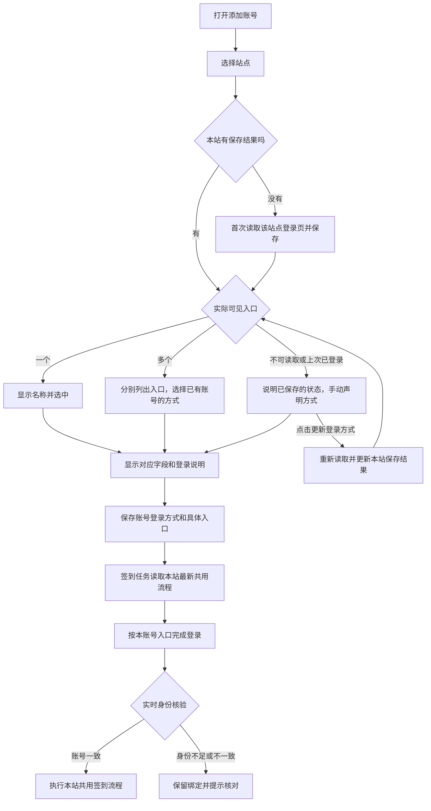

# 按页面选择具体登录入口

新增单个账号时，先选择站点，再使用本站保存的登录入口。首次没有保存结果时读取一次登录页并保存；之后添加其他账号、重新打开界面或重启浏览器都使用保存结果，只有点击「更新登录方式」才重新读取网页。检测结果包含具体名称，不用站点默认登录方式推测，也不根据输入过的密码猜测。

一个入口时自动选中；多个入口时需要选择自己已有账号使用的方式。同一页的 Google、Linux DO 和 Discord 都属于 OAuth，但显示为三个独立选项。

账号字段紧随登录入口显示。共用签到流程说明放在后面的可展开详情中，避免在侧边栏里挤占填写区域。账号标识使用本站用户名或完整邮箱，用户 ID 在身份核验后独立绑定。

| 入口                          | 需要保存的内容                               | 实际登录                                         |
| ----------------------------- | -------------------------------------------- | ------------------------------------------------ |
| 站内账号密码                  | 本站用户名、本站密码                         | 填本站登录表单                                   |
| GitHub                        | GitHub 用户名、GitHub 密码；本站身份标识可选 | 进入 GitHub 官方登录页，使用该账号的 GitHub 凭据 |
| Google、Linux DO 等第三方入口 | 用于核对本站身份的账号标识、选定入口         | 在对应提供方页面登录或授权                       |
| Passkey / 通行密钥            | 本站账号标识、启用 Passkey                   | 在浏览器或系统提示中确认                         |
| 邮箱验证码、短信验证码、扫码  | 本站用户名或完整邮箱、选定入口               | 在页面完成验证，核验实时账号身份后继续           |

第三方授权和页面验证模式不要求填写第三方密码。账号标识用于确认本站当前登录身份；邮箱验证码首次绑定不能用显示昵称或邮箱的前半段代替。



## 归属与保存

`site.checkin.workflow` 仍属于准确的站点 ID。同站点所有账号共享最新签到流程，新站点独立保存。

`site.loginDiscovery` 长期保存本站的登录入口及读取时间，不设自动过期时间。它随站点参与备份，同站点账号共用；不同站点分别保存。登录地址的绑定使用 SHA-256 指纹，元数据不保存地址中的授权查询参数。

结束学习只更新本站模板和共用流程，保留当前账号及其他账号的独立登录方式与具体入口。学习到第三方按钮不能把验证码、Passkey 或已经明确选择的提供方改成另一种登录方式。

`account.loginMethod` 保存执行模式；`account.loginEntry` 保存具体入口的安全语义信息：

```js
{
  key: 'oauth:google',
  method: 'oauth',
  label: 'Google',
  provider: 'google',
  matchText: '使用 Google 登录',
  hrefPath: '/oauth/google'
}
```

字段不会保存授权 query、完整授权 URL、DOM 节点或 CSS class。切换登录模式、移动到其他站点时清除不相符的旧入口。任务读取当前账号的入口，不把入口偏好放进站点共用签到流程。

## 页面读取与执行

管理页通过 `PROBE_LOGIN_PAGE` 请求后台。后台只按已保存的站点 ID 解析登录地址，读取顶层页面的 `READ_LOGIN_OPTIONS`。需要新标签页时使用后台标签页，读取结束关闭自己创建的标签页。现有标签页保留。

读取过程不填写凭据、不点击登录、不清理 Cookie、不改变代理。两个连续一致的页面样本确认后提供选项，并将结果保存在本站配置中。普通请求只读保存结果；首次读取失败或当时已登录的状态也会记住，避免每次添加账号都重复打开网页。

「更新登录方式」会重新读取。更新失败时保留旧的可用入口并显示失败原因；成功时更新本站列表，保留各账号原来选定的方式和凭据。编辑已有账号默认只读保存结果，没有结果也不会自动打开网页。

修改登录 URL 后显示地址已改变并等待手动更新。切换站点或关闭界面后，旧响应不能覆盖当前选择。实际网页登录和签到仍需要进入业务页面，但不会额外打开识别登录方式的标签页。

执行时按选定入口的名称、提供方和安全路径重新寻找当前页面控件。同页有多个 OAuth 入口时，选定入口缺失会提示手动更新本站登录方式，不自动改点另一提供方。

验证码和扫码使用独立的 `manual` 阶段，不进入密码填写或账密提交证明。首次绑定要求连续实时 API 身份、用户 ID，以及与填写的本站用户名或完整邮箱精确一致的标识。已有用户 ID 必须一致，其他账号已经绑定的 ID 不能借用。

等待页面验证使用专门的 `MANUAL_LOGIN_WAITING` 消息。后台保留当前队列和代理，防止下一个账号在验证期间改变会话；用户取消、关闭页面或等待超时后才释放。等待时限不会因页面刷新而无限延长，结束的任务不能恢复签到或更新身份。已经可见的具体入口直接进入登录，不再先等待未登录页面的会话轮询窗口。

## 回归验证

- `login-page-probe.test.cjs`：后台读取、站点隔离、超时清理、缓存、稳定入口和安全字段。
- `account-batch-ui.test.cjs`：实际组件状态、具体入口、字段切换、保存、旧账号编辑、乱序结果和重试。
- `login-content-catalog.test.cjs`：真实内容入口、多个提供方、隐藏及设置控件排除、精确点击和页面登录身份。
- `login-message-routing.test.cjs`：源码和打包产物的真实后台消息路由。
- `page-login.test.cjs`、身份相关测试：账密隔离、自动识别、固定 ID、账号切换和共用流程回放。
