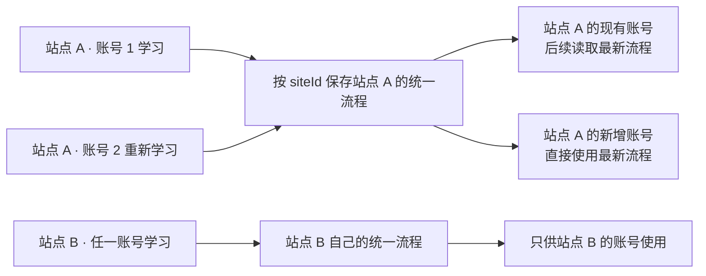
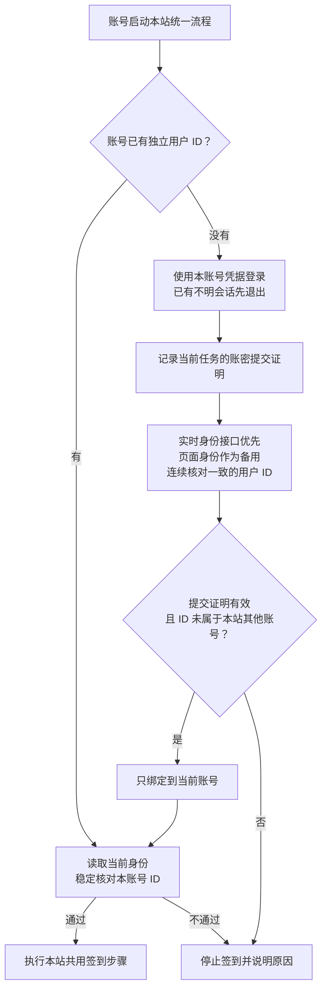

# 站点共用签到流程

## 数据归属

每个站点 ID 对应一套签到配置，保存在该站点的 `checkin` 字段中。登录入口和字段
选择器属于当前站点；账号默认根据实际页面识别登录方式。账号通过 `siteId` 引用
站点，账号数据不保存单独的签到步骤。

| 数据                                   | 归属     | 更新影响                   |
| -------------------------------------- | -------- | -------------------------- |
| 登录入口、字段选择器                   | 当前站点 | 本站使用对应登录方式的账号 |
| 签到动作、页面路线、身份核验页         | 当前站点 | 本站全部账号               |
| 用户名、密码、第三方凭据、登录方式偏好 | 当前账号 | 当前账号                   |
| 用户 ID、已抓取会话                    | 当前账号 | 当前账号                   |
| 账号代理与签到结果                     | 当前账号 | 当前账号                   |

同一域名可以存在不同站点 ID，它们的学习结果、身份分组、登录成功标志和适配信息
互不借用。新建站点使用自己的初始配置，不会继承已有站点学到的流程。

## 按当前页面识别登录

账号默认使用 `auto`，界面显示“自动识别当前页面”。默认方式不继承站点的
`loginMethod`，也不因账号只保存一套凭据而提前猜测登录入口。各站点的任务读取
自己的页面：可见站内账密表单采用表单登录，可见 GitHub、Passkey 或其他授权入口
采用对应方式。页面入口未出现时等待加载或进入本站登录页后再次识别。

账号明确指定的表单、GitHub 或其他兼容方式继续有效。自动模式保留账号已有的
站内与 GitHub 凭据；切换到自动模式不因站点默认方式而清空另一套凭据或用户 ID。
批量新增账密账号同样默认自动识别，并为各账号保留站点密码。

任务通过 `RESOLVE_LOGIN_METHOD` 记录本轮页面识别结果。后台检查当前任务、
本站顶层页面、账号的自动偏好、最新归属和所需凭据，再允许提交表单或进入对应
第三方登录流程。GitHub 凭据仍仅在 GitHub 官方页面填写。识别结果属于当前任务，
不会修改站点配置或其他账号的登录偏好；新一轮登录重新根据页面识别。

## 学习与更新

学习模块负责临时录制会话、生成候选登录配置和签到步骤，并更新会话所属站点。
录制期间账号如果换到另一个站点，会拒绝把旧事件写入新站点。

站点模块负责按站点 ID 保存和提供配置。签到模块在启动每个任务时读取当前站点的
最新配置。更新不向账号复制流程，也不向同域其他站点复制流程。

学到的流程保存后会启用本站回放。其他账号直接使用本站流程，任一账号后续学习
都会替换本站共用的步骤。明确选择“登录即签到”，或站点原来已经采用该模式时，
才按该方式保存；没有看见按钮不构成自动更改签到方式的依据。

## 首次账号身份确认

站点共用流程包含“在哪里确认身份”，不包含演示账号的用户 ID。

表单任务在提交登录前，通过 `FORM_CREDENTIALS_SUBMITTED` 确认本轮使用了当前账号
的凭据。后台只接受当前任务、扩展自身发送者、本站顶层页面，并检查最新账号归属和
凭据与任务快照一致。

第一次绑定必须有本轮提交证明，以及登录后两次一致的页面或接口用户 ID。
后台再次检查本账号原绑定和同站其他账号的 ID，使用保留既有绑定的写入方式。
保存失败时不会继续回放或记成功。

回放路线的跳转预算属于本轮登录会话。核对旧账号后切换登录时，会保留完整日志，
但旧会话的身份页跳转、重复目标和往返记录不占用新会话的预算。同一次登录内的
真实重定向或跳转循环仍会被拦截，身份核验也不会因重试而跳过。

开始新的登录、重新登录或清除 Cookie 会使旧提交证明失效；正常验证和签到页面
跳转会保留同一次登录的证明。已有绑定仍按用户 ID 核验，账号备注不参与覆盖 ID。

GitHub 等账号继续使用其专用登录方式和原有核验逻辑，学习站点入口不会无故清空
兼容的账号登录方式覆盖。

## 实时身份判断

身份读取优先使用当前登录会话下的实时身份接口。身份请求禁用缓存，并验证响应来源，
避免把登录跳转页或旧缓存误认为当前用户资料。已知接口之外的身份配置仍属于本站，
不会借用其他站点的配置。

本地登录态中的用户 ID 只用于提供身份请求所需的提示，不直接作为已登录账号的证明，
也不把目标账号的 ID 填进请求后当作识别结果。接口无法取得有效身份时，才使用可见
账号区域的页面身份；账号列表、邀请信息和隐藏控件不参与当前用户判断。

当前业务页已经能通过实时接口确认本账号时，可以先完成身份核验，再执行本站保存的
签到路线；不再仅为读取页面文字强制返回资料页。签到步骤和它们所需的页面跳转仍按
本站统一流程执行。

页面暂未渲染完整或身份接口暂时失败时，会继续重新读取接口和页面，核对连续一致的
用户 ID。可靠的实时接口身份优先于旧页面显示；登录后稳定的当前用户 ID 与本账号的
固定目标 ID 一致，才能继续本站流程。首次账号绑定还必须保留本轮凭据提交证明。

已有绑定的账号即使是本站唯一账号，当前用户 ID 未知且没有本轮可靠的身份确认时，
也会停止签到，不以账号数量代替身份证据。“退出再登录”的第二次登录同样需要身份
核验：表单或 OAuth 登录后重新采样并确认身份，Token 登录必须明确核对到本账号；
只看见登录成功标志、身份仍未知或有冲突时，不会把本轮记为签到成功。

单次身份响应或页面出现不同用户 ID、复核后仍未消除的身份证据冲突，会停止签到。
日志会说明读取来源、观察到的用户 ID 和目标用户 ID，错误卡片显示“账号身份信息
相互冲突”，并保留原有账号绑定。此类错误不会统一引导为重新学习选择器。

## 减少正常流程等待

页面已经出现可识别的登录表单或登录成功证据时，立即判断，不再先固定等待两秒。
页面仍在加载时继续轮询，验证码和实际失败处理保留原来的等待规则。

已经渲染登录表单或登录后页面、且没有公告时，公告出现观察期由最多 2.5 秒缩短到
250 毫秒。实际点击仍检查并清除遮挡，尚未渲染完成的页面保留较长观察期。

身份接口在同一个地址不接受普通 Cookie 时，紧接着尝试当前浏览器身份提示头，
避免先试完所有不相关接口。当前页面记住成功接口的地址和认证类型，后续采样
仍重新请求服务端；不缓存身份结果、用户 ID 或凭据值。路线失效或登录态清理后
重新探测，首次账号身份的稳定采样与固定用户 ID 核验仍保留。

点击前不再固定等待 600 毫秒。登录后的验证观察窗口在出现明确登录成功控件、
且没有登录或二次验证表单时可以提前结束。签到后的快速结束只使用相对点击前
新出现或变化的成功证据；原有“已签到”文字不能盖过随后出现的验证码。
每轮先检查验证码再检查完成信号，未出现完成信号时仍保留完整观察窗口。

## 模块入口

- `learning/service.js`：临时会话、录制事件、结束学习，写入指定站点。
- `sites/service.js`：站点数据，按站点 ID 读取与保存。
- `accounts/service.js`：账号凭据和个人身份，处理有证明的身份保存。
- `checkin/service.js`：按当前站点创建任务，管理登录证明与任务状态。
- `checkin/content.js`：使用账号凭据登录、稳定核验身份、回放本站流程。
- `entries/background.js`：消息路由；不拥有站点流程副本。

## 回归覆盖

服务测试执行实际学习保存和任务创建函数，检查：

- 账号 1 学习 A 后，本站其他账号使用 A。
- 账号 2 更新 B 后，本站现有和新增账号使用 B。
- 相同域名的其他站点保持自己的流程，新站点也不会借用。
- 账号身份和账号数量仅在当前站点分组，教师账号 ID 不被复制。
- 首次身份绑定需要当前账号的提交证明，拒绝外站、子框架、过期任务、凭据变化、
  已属于其他账号的 ID 和已有绑定冲突。
- 稳定身份保存成功后直接回放；身份变化、保存失败或无法保存时不执行签到。
- 学习期间账号换站点时，旧录制不能更新新站点。
